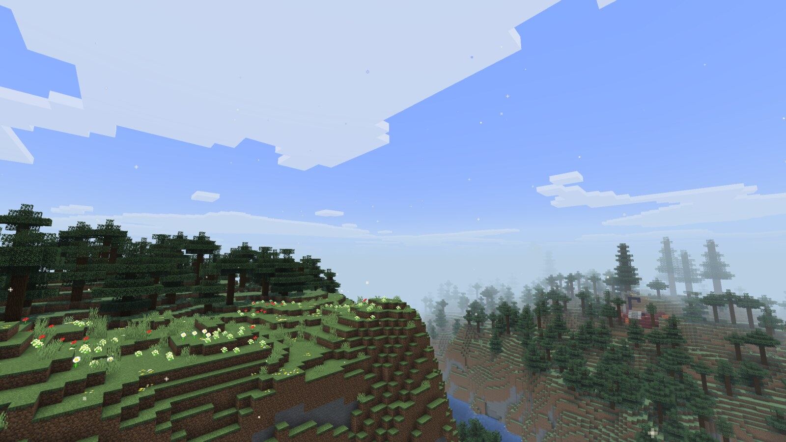

# LiteLights

LiteLights is a client-side Fabric mod for Minecraft 26.3. It adds shadows, better water, sky, fog, weather and ambient particles, but keeps the vanilla look, and it's fast enough to run on a normal setup next to Sodium. Every effect has its own setting, and most of them are on by default.



*LiteLights on Sodium, with no resource packs.*

## What it does

- **Shadows:** cached sun and moon shadows, creature shadows instead of vanilla's round blob, and five detail levels.
- **Lighting:** bloom, sunbeams (above and under water), glint on water, ice, metal and glass, colour grading by time of day, and enchantment outlines on held items and armour.
- **Water:** natural colours with depth, reflections, caustics, edge foam, large water textures, splashes, ocean waves and wakes behind boats and swimmers.
- **Sky and fog:** LiteLights' own sun, moon and stars, clouds in one or two layers, haze with mist banks and biome colours, the aurora borealis, meteor showers, distant fireworks and rainbows after the rain.
- **Weather:** its own rain and snow, rolling mist along the ground (or soft 3D puffs if you prefer), storm fog for each kind of storm, sandstorms and haboobs, puddles in the rain, snow on leaves and under trees, rain drips and wall streaks, and frost, snow and sand on windows.
- **Particles and plants:** fireflies, dust, pollen, better fire and smoke, ember veins, and swaying grass, plants and leaves.
- **Far terrain:** Voxy and Distant Horizons land gets the same haze, light, water and shadows; Calculate distance on the Shadows page lines the near shadows up with it.
- **Overlays:** softer blocks like grass and sand spill onto harder ones, with textures made from whatever resource packs you have loaded. This one needs Continuity.

The first time you start the game with LiteLights, it asks how powerful your computer is and sets itself up to suit, or keeps the creator's recommended settings. Everything is in LiteLights' settings screen (through Mod Menu or a keybind you set), and in Sodium's Video Settings if you have Sodium.

## Install

1. Install Fabric Loader 0.19.3 or newer and Fabric API 0.160.5 or newer for Minecraft 26.3, on Java 25.
2. Drop the jar from the [latest release](../../releases/latest) into your `mods` folder.
3. Optional: Sodium, Continuity (for overlays), Mod Menu. Recommended alongside: LambDynamicLights, LambdaBetterGrass, Visuality and Subtle Effects.

## Compatibility

- Works with Sodium 0.9.2 and 0.9.3 betas, or the vanilla renderer.
- Needs OpenGL 4.1 or newer, or Vulkan. Without Sodium, swaying plants need OpenGL 4.6 (or Vulkan); with Sodium they work on 4.1.
- Doesn't work with Iris. It's a different approach to the same problem, so pick one.
- If you have Particle Rain, Immersive Storms, Weather Glass, Wakes, Big Water or Streams Reflowing, LiteLights turns off its own version of whatever that mod does, and the settings screen tells you which.
- Voxy and Distant Horizons both work (one at a time). Punchy! works too, outlines included.
- With Almanac (on your game or only on the server), LiteLights' rain, snow, puddles, sandstorms and the rest follow the seasons: snow over winter plains, rain in a winter desert. With Voxy or Distant Horizons too, far land follows Almanac's season as well: far snow comes and goes in patches with the snow near you, and far grass and leaves take the season's colours (Almanac 0.1.2 or newer; 0.1.3 recommended). Other seasons mods that change vanilla's own rain and snow should work the same way, but I haven't tested them.

**On a Mac:** LiteLights only asks for OpenGL 4.1, so it should run, but I haven't been able to test it on real Apple hardware yet. An earlier version froze on a friend's M4 Max as the world loaded, on both OpenGL and Vulkan. My best guess is the Mac's graphics driver choking on LiteLights' big terrain shaders, but I haven't been able to confirm it. LiteLights now also caps the few shader loops that could run away on bad data (Shader loop safety caps, on by default under General > Compatibility; I don't recommend turning them off), but that isn't confirmed to fix the freeze either. If it freezes for you, these steps help me find the part that breaks:

1. Load a world with the default settings. If it loads, you're all set.
2. If it freezes, quit the game (Force Quit if you have to) and start it again. If the freeze happened while the world's blocks were being drawn, the title screen now asks whether to use Minecraft's own block shading for that session: say yes to play straight away (your saved settings don't change). To find the cause, or to keep it that way, open LiteLights' settings from the title screen (through Mod Menu, or Video Settings with Sodium) and go to General > Compatibility > Mac troubleshooting. Turn on **Use vanilla terrain shading**, close the settings and load the world again.
3. If it still freezes, the problem isn't in LiteLights' block shading. Send me the log.
4. If it loads, go back to Mac troubleshooting, turn **Use vanilla terrain shading** off and turn off every switch under it. Then turn them back on one at a time, closing the settings and loading the world after each, until it freezes. If it freezes even with all of them off, stop there.
5. Send me the log from the run that froze, and tell me which switch you turned on last.

Each change takes effect when you close the settings. For the log, send me the lines in `logs/latest.log` that start with `LiteLights:`, which say how far it got and which parts were in (if one of them is a "slow start-up step" warning, send the lines under it too), along with the macOS hang report from `~/Library/Logs/DiagnosticReports` and any `hs_err_pid*.log` from the game folder. Until I've fixed it, you can keep playing with every switch on except the one that froze.

If something breaks, please open an issue with your log and mod list and I'll take a look.

## Credits

LiteLights is written from scratch. A lot of the ideas came from other mods though, and they deserve the credit for those:

- **ImmersiveVFX** by Shinyflvres: the cached shadow map, forward-shaded effects and biome atmosphere.
- **Big Water** by Tec: large water textures. LiteLights ships Big Water's CC0 water and lava textures.
- **Particular** by Chai: the jump splash.
- **Immersive Storms** by TheDeathlyCow: storm atmosphere.
- **Squall** by comedy: lightning flickering inside the clouds.
- **Tempestra** by Moth_SKW: branching lightning bolts.
- **Weather Glass** by duffopuffo: weather on glass.
- **Particle Rain** by pigcart: rain drips and wall streaks.
- **Wakes** by Goby56: wakes behind boats and swimmers.
- **Falling Leaves** by Fourmisain: leaves falling from trees on the wind.
- **You Must Have The Rain** by AppleNButter: rainbows after the rain.
- **Snow** by IMB11: leaves turning white while it snows, and snow under trees.
- **Swinging Lanterns** by Rilith: lanterns and their chains swinging in the wind.
- **Lava Particles | More** by stepqq: the heat shimmer.
- **Continuity** by Pepper_Bell, which the overlays draw through.
- **LambDynamicLights** and **LambdaBetterGrass** by LambdAurora, **Visuality** by PinkGoosik and **Subtle Effects** by MincraftEinstein, which I recommend running alongside it.

None of those mods' code, shaders or textures were used, apart from Big Water's CC0 textures. The full list with links is in [CREDITS.md](CREDITS.md).

## License

MIT, see [LICENSE](LICENSE). A few things in here aren't mine and keep their own terms, and `LICENSE` lists them:

- the shaders in `shaders/core/` are modified copies of Minecraft's and still belong to Mojang;
- Big Water's textures are CC0;
- the hash functions in `noise.glsl` are Dave Hoskins' (MIT);
- the rain splash sprites and the icon are made from vanilla textures.

## Building

```
JAVA_HOME=/path/to/jdk-25 ./gradlew build
```

Gradle has to run on Java 25 (newer JDKs can't load the build script yet). The jar ends up in `build/libs/`.
